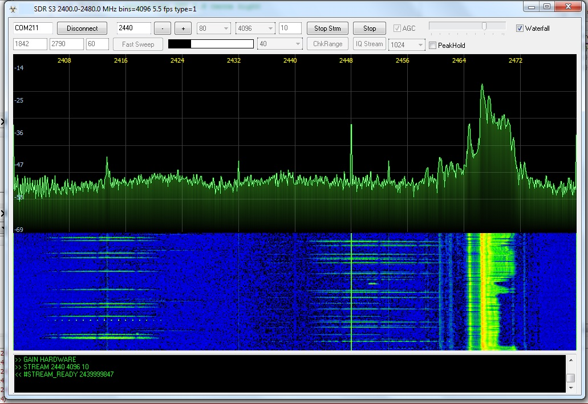

# ESPs3 SDR — ESP32-S3 Spectrum Analyzer + Delphi client




**Open Hardware · Open Source · Open RF Research — Beyond Limits**

Анализатор спектра 1842–2790 МГц на встроенном Wi-Fi радио **ESP32-S3**
(Waveshare ESP32-S3-Zero / S3 Mini / DevKit) — без внешнего SDR-железа.

Плата делает короткий снимок эфира (raw I/Q, 10 бит), считает FFT,
детектирует сигналы и отдаёт по USB готовый спектр, сжатые I/Q-блоки
или текстовые события. Delphi 7 клиент рисует спектр и водопад
и управляет приёмником.

> Receive-only. Пассивный RF-мониторинг.
> Применение: Образование, исследоватльские проекты по : RF-детекция дронов (пульт / видео / телеметрия),
> исследование спектра, поиск помех 2.4 ГГц.

---

## Состав

| Файл | Назначение |
|---|---|
| `ESP32S3_SDR_TEST_v7.0.ino` | прошивка (Arduino-ESP32) |
| `Unit1.pas / Unit1.dfm` | главная форма, приём, отрисовка |
| `ComPort.pas` | работа с COM, чистый WinAPI |
| `IQDecoder.pas` | декодер IQR v1/v2, CRC32, сохранение `.cs16` |

Компоненты устанавливать не нужно.

**Сборка прошивки:** Board `ESP32S3 Dev Module`, `USB CDC On Boot: Enabled`,
библиотека **ESP-DSP** (Library Manager).

---

## Как работает прошивка

- **Захват.** Недокументированный dump-движок пишет I/Q в зарезервированную
  SRAM `0x3FCD0000`. Снимок до 16380 пар (~205 мкс при 80 Msps).
  Сентинелы проверяют неполный захват и переполнение.
- **PLL.** Прямая настройка SDM + скан 512 ёмкостей VCO, центр самой длинной
  зоны захвата, кэш ёмкостей. Режим **M1** — нормальный (2210–2790),
  **M2** — 5/6 (1842–2325).
- **FFT.** ESP-DSP, окно Blackman-Harris, усреднение нескольких блоков,
  быстрый log, подавление DC ±150 кГц, ориентация оси по RF.
- **DSP-воркер** на ядре 0 (FreeRTOS), команды — в `loop()`.
  Состояния: `IDLE / STREAM / SWEEP / DETECT / IQSTREAM`.
  После остановки воркер шлёт `#IDLE`.
- **Сжатие IQ (IQR v2).** Блоки по 1024 пары, режимы RAW / MIN / CENTER / DELTA
  (Rice), CRC заголовка и данных, padding до 16 бит.

---

## Протокол


| Команда | Действие |
|---|---|
| `PING` | > `PONG` | тестовый пинг |
| `INFO` | режим, rate, width, LO, PLL, gain, стек, версия IQR |
| `STOP` / `IQSTOP` | остановка, позже `#IDLE` |
| `STREAM f fft fps` | спектр на частоте f; fft 512–4096; fps 1–30 |
| `SWEEP a b step fft` | панорама a..b, шаг 1–60 МГц |
| `IQSTREAM f 1024\|256` | пакетный прореженный I/Q (без антиалиасинга) |
| `DET?`, `DETTHR n` | треки / порог 6–20 дБ |
| `CONV lo +\|-`, `CONVOFF` | пересчёт частот для внешнего конвертора |
| `FREQ f` | перестройка LO |
| `RATE 80\|40\|16` | частота дискретизации = ширина кадра |
| `WIDTH 20\|40` | аналоговая ширина канала |
| `FILTER a[,b]`, `LPF n\|AUTO`, `BANDWIDTH МГц` | RC-фильтр baseband |
| `GAIN HARDWARE` / `GAIN MANUAL n` | AGC / ручное усиление 0–82 |
| `RF n`, `BB n`, `DC0..3 n`, `IQ a,p` (+ `AUTO`, `?`) | ручные ступени |
| `STAGES?` | ступени, PLL, LO |
| `DIAG n` | статистика I/Q |
| `DCCAL` | калибровка DC (только MANUAL) |
| `CAP16 n` | сырой IQ8: `DATA n sum us` + 2n байт |
| `CAPIQC n` | сжатый IQ: `DATA_IQR n nblocks us` + IQR-блоки |
| `LED r g b`, `LED AUTO`, `LEDTEST` | светодиод |


**Спектральный кадр** (бинарный, 36 байт заголовок + N байт данных):

```
TSpectrumHeader = packed record
  Magic: Cardinal;   // $5AA55AA5, на проводе A5 5A A5 5A
  FrameType: Byte;   // 1 = STREAM, 2 = SWEEP
  Reserved: Byte;
  StartHz, StopHz: Double;
  BinsCount: Word;   // 16..16384
  MinDb, DbStep: Single;   // dB = MinDb + code*DbStep
  Timestamp: DWORD;
end;
```

---

## Программа (Delphi 7-2009)

Весь приём — в `TSdrRxThread`; GUI только рисует
(`TCriticalSection + PostMessage`). Кадры проверяются по заголовку,
мусор и NaN отбрасываются, FPU-исключения замаскированы.

### Связь
- **edtDeviceCOM** — имя порта.
- **Connect / Disconnect** — открытие (5 попыток), `PING`, `INFO`;
  отключение со `STOP`.

### Частота и режим
- **edtCenterFreq** — LO, 1842–2790 МГц.
- **– / +** — шаг 1 МГц (в STREAM — перезапуск, в IDLE — `FREQ`).
- **cbSampleRate 80/40/16** — ширина кадра: LO±40 / ±20 / ±8 МГц.
- **cbWidth 20/40** — аналоговая полоса.
- **cbFFT 512–4096** — разрешение: 156 / 78 / 39 / 19,5 кГц при 80 Msps.
- **edtFPS** — кадров/с в STREAM.
- **Stream** — `WIDTH > RATE > GAIN > STREAM`, запуск приёма.
- **Stop** — `STOP`, ожидание `#IDLE`, остановка потока.

### Свип
- **Start / End** — диапазон, МГц.
- **edtStep** — шаг (60 = 75% от 80 МГц, края фильтра отбрасываются).
- **Fast Sweep** — `RATE 80, WIDTH 40, AGC`, `SWEEP`.
  Предпроверка: не более 16384 бинов.
- **ChkRange** — проверка захвата PLL с шагом 100 МГц: `pll=cap[first+len] mode`.

### Усиление
- **AGC** — `GAIN HARDWARE` (уровень «дышит»).
- **tbGain 0–82** — ручной индекс усиления (не дБ).

### Вид
- **Waterfall** — 60% спектр + 40% водопад, адаптивная шкала.
- **Peak Hold** — оранжевая линия максимумов, сброс при смене частоты.
- **IQ Stream + cbIQDecim** — пакетный I/Q с прореживанием 1024/256.
- **pbScope** — спектр с градиентной заливкой и автошкалой.
- **Memo1** — лог
- **Gauge1** — fps или прогресс ChkRange.

---

## Типовой сеанс

1. `Connect` > `PONG`, `INFO`
2. `ChkRange` — карта захвата PLL вашей платы
3. `2440 / 80 / 40 / 1024 / 10`, AGC выкл., Gain 60 > **Stream**
4. `2400–2480`, шаг 60 > **Fast Sweep**
5. **Peak Hold** — для FHSS (Bluetooth, RC-аппаратура)
6. **Stop** > **Disconnect**

---

## Ограничения

- Снимки с паузами: видна ~1–5% времени эфира, не непрерывный поток.
- Уровни не откалиброваны (dBFS-подобная шкала).
- Края диапазона зависят от экземпляра платы.
- Узкая постоянная линия 2448 МГц — вероятно, гармоника 48 МГц USB.
- `IQSTREAM` — прореживание без фильтра, спектр с наложением.

---

## Credits

- **ESP-SDR** (ESPARGOS project) — открытие raw I/Q пути ESP32,
  dump-регистры, протокол burst-захвата.
  https://espargos.net/espsdr/
- **eSpDR** — PLL-тюнинг ESP32-S3, режим 5/6, PBUS-управление ступенями,
  формат IQR (0BSD).
- **ESP-DSP** (Espressif) — FFT и окна.
- Espressif ESP-IDF / Arduino-ESP32.


